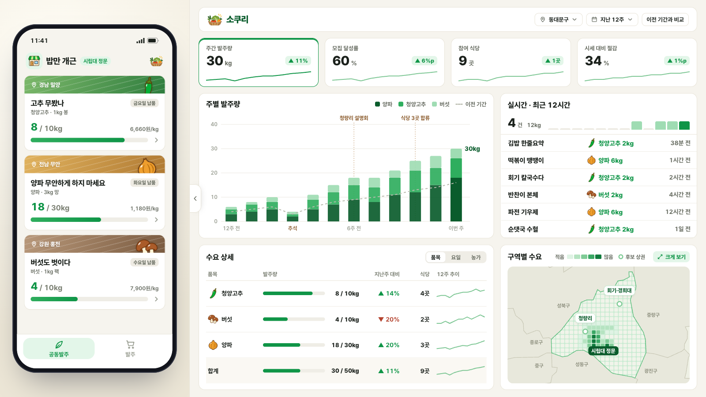

# 공동 발주 시연 화면

동네 식당들이 산지 농가에 함께 발주하는 서비스의 시연 화면

| 기간 | 대회 | 결과 | 배포 |
|---|---|---|---|
| 2026.10 ~ 11 | 서울시립대 창업지원단 창업 공모전 | 진행 중 | https://noru-0731.github.io/group-order-demo/ |

## 문제의식

- 동네 식당 사장님은 다음 주 판매량을 모르는 채로 재료 주문량 결정
- 혼자 주문하면 최소 구매 단위와 배송비 전부 부담, 산지 거래처 확보 어려움
- 결국 단가가 들쭉날쭉한 소량 구매에 의존

## 해결 방법

- 같은 지역 식당의 주문을 모아 소규모 농가에 공동 발주
- 주 1회 구역별 정기 배송으로 시작, 늘 쓰는 핵심 재료를 농가와 연결
- 수익은 배송을 맡고 받는 최소한의 유통 마진
- 쌓인 주문 데이터로 지역 외식업 수요를 읽는 서비스로 확장

## 주요 기능

- 사장님 화면(휴대폰): 공동발주 묶음(품목, 규격, 납품 요일, 최소 출하량까지 모인 양), 필요한 만큼 담아 길게 눌러 발주
- 관리자 화면: 확정된 공동발주, 참여 식당, 주문 기록, 이번 주 모인 물량, 운영 상권 지도, 공동발주 현황, 주문 기록 표
- 주문 합계가 농가의 최소 출하량에 도달하면 두 화면에 동시에 출하 확정 표시
- 주문 한 건이 주문 기록 한 줄(점포, 상권, 품목, 납품 요일)로 쌓임
- 지도에서 상권을 누르면 그 구로 다가가고, 오른쪽에 그 상권의 점포 목록 표시(운영 상권은 주문량, 후보 상권은 후보 점포)

시연 순서

1. 청양고추 묶음(8 / 10kg) 누르기
2. 2kg 담긴 것을 확인하고 길게 눌러 발주
3. 10 / 10kg 달성과 출하 확정, 주문 기록에 한 줄 추가
4. G로 같은 상권의 다른 주문이 들어와 양파 묶음 확정

시연 키

| 키 | 동작 |
|---|---|
| H | 휴대폰 화면 숨기기·꺼내기 |
| G | 같은 상권 식당의 주문 7건 연달아 들어오기(한 번만, R 뒤 다시 가능) |
| R | 처음 상태로 되돌리기 |

## 만들며 부딪힌 문제

- 관리자 화면의 움직임 과다
  - 해결: 움직임 줄이기
- 자동 주문이 처음부터 켜져 있어 시연 흐름과 충돌
  - 해결: 자동 주문 제거, 주문은 휴대폰 발주와 키로만 발생
- 7분 발표 안의 짧은 시연에 비해 기능 과다
  - 해결: 농가 목록, 발주, 관리자 반영 장면만 남기고 나머지 제거
- 사장님 주문이 다른 주문에 묻혀 관리자 화면에서 보이지 않음
  - 해결: 피드 맨 위 고정, 큰 글자와 진한 강조, 성동구 지도 숫자 강조
- 발표장 화면 크기를 모름
  - 해결: 1280x720부터 2560x1440까지 화면 높이에 맞춰 확대·축소, 스크롤 없이 한 화면
- 시연 중 오작동 위험(중복 확정, 빈 주문, 키 반복 입력)
  - 해결: 확정 중 조작 잠금, 빈 주문 차단, 반복 입력 무시
- 모집 진행 막대가 시연 중에 변하지 않아 역할이 없음
  - 해결: 사장님 발주와 다른 구 주문이 더해져 목표량을 채우는 장면 추가
- 주문이 무작위라 시연마다 결과가 달라짐
  - 해결: 들어올 주문을 정해 둔 목록으로 교체
- 5kg 단위 발주라 절감액이 몇천 원으로 작게 보임
  - 해결: 식당의 실제 구매 단위에 맞춰 10kg 단위로 변경, 가격을 도매 시세에 맞춰 조정
- 이모지가 기기마다 다르게 보이고 화면과 어울리지 않음
  - 해결: 한 화풍의 그림으로 교체

- 화면의 규모와 강조점이 발표 내용과 다름(서울 전역 20kg 단위 주문, 절감액 강조)
  - 해결: 발표 자료에 맞춰 대학 앞 상권 한 곳, 2kg 소량 주문, 최소 출하량 10kg 도달 장면으로 재구성하고 절감액 표시 제거
- 확정된 묶음에 다시 주문하면 최소 출하량을 넘는 숫자가 표시됨
  - 해결: 남은 양까지만 담기게 하고 확정된 묶음은 다시 담기지 않게 처리

## 회고

- 첫 레이아웃부터 만족: 평소 모아 둔 오픈소스 UI와 화면 레퍼런스에서 출발해 처음 뽑은 구성이 그대로 채택할 수준
- 화면 구성을 글로 먼저 정리: 사장님 화면과 관리자 화면에 들어갈 것, 두 화면이 이어지는 장면, 움직임까지 문서로 정한 뒤 제작
- 고객 목소리에서 출발한 주제: 식당 사장님 커뮤니티 글을 모아 발주와 거래처 고민을 확인한 뒤 방향 결정
- 여러 번 바뀐 주제: 이전 주제 두 개를 접고 대체 재료 제안을 거쳐 공동 발주로 확정, 화면은 방향이 정해진 날 초안 제작
- 시연용 화면 단계: 주문, 배송, 정산은 실제로 연결하지 않고 가짜 데이터로 흐름만 구현
- 진행 중인 작업: 발표 전이라 결과와 실제 사용자 반응은 아직 없음

## 기술

- HTML 한 장짜리 시연 화면, GitHub Pages 배포
- AI 도구: 화면 기획과 제작을 AI 코딩 도구(Claude Code)로 진행

## 자료 출처 · 실행

- 서울 구 경계: southkorea/seoul-maps (통계청 2013)
- 글꼴: Pretendard
- 가게, 농가, 주문은 시연용으로 만든 값
- `index.html`을 브라우저로 열기
