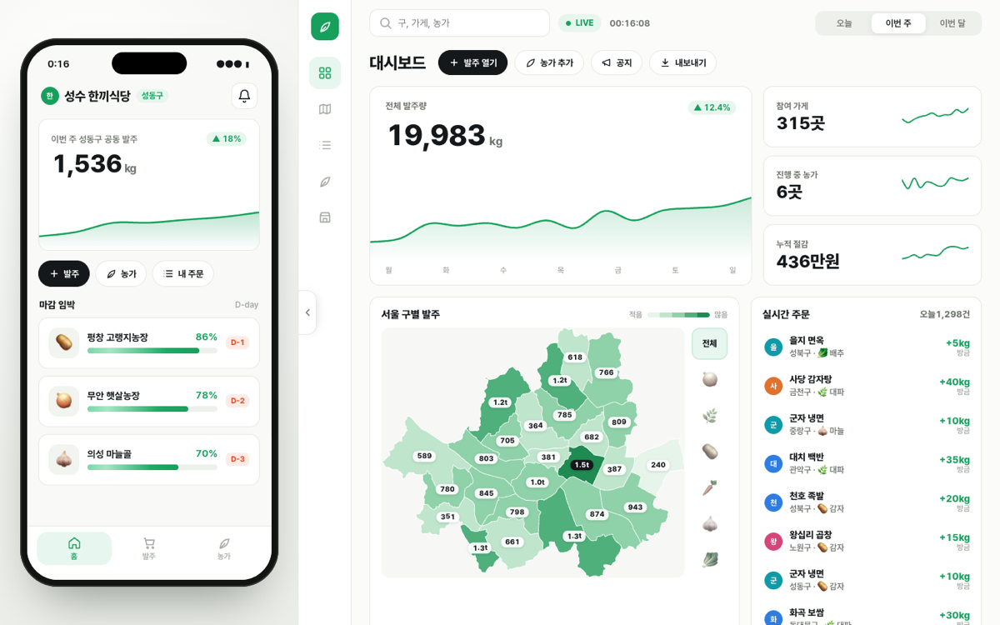

# 공동 발주 시연 화면

동네 식당들이 산지 농가에 함께 발주하는 서비스의 시연 화면

| 기간 | 대회 | 결과 | 배포 |
|---|---|---|---|
| 2026.10 ~ 11 | 서울시립대 창업지원단 창업 공모전 | 진행 중 | https://noru-0731.github.io/group-order-demo/ |

## 문제의식

- 동네 식당 사장님은 다음 주 판매량을 모르는 채로 재료 주문량 결정
- 혼자 주문하면 최소 구매 단위와 배송비 전부 부담, 산지 거래처 확보 어려움
- 결국 단가가 들쭉날쭉한 소량 구매에 의존

## 해결 방법

- 같은 지역 식당의 주문을 모아 소규모 농가에 공동 발주
- 주 1회 구역별 정기 배송으로 시작, 늘 쓰는 핵심 재료를 농가와 연결
- 수익은 배송을 맡고 받는 최소한의 유통 마진
- 쌓인 주문 데이터로 지역 외식업 수요를 읽는 서비스로 확장

## 주요 기능

- 사장님 화면(휴대폰): 홈, 발주 신청(길게 눌러 확정), 농가 모집 현황
- 관리자 화면: 전체 발주량, 서울 구별 발주 지도, 실시간 주문, 구별 순위, 농가 모집 진행
- 두 화면이 같은 데이터로 연동

시연 키

| 키 | 동작 |
|---|---|
| H | 휴대폰 화면 숨기기·꺼내기 |
| G | 여러 구에서 주문 연달아 들어오기 |
| P | 자동 주문 켜기·끄기 (처음에는 꺼진 상태) |

## 만들며 부딪힌 문제

- 관리자 화면의 움직임 과다
  - 해결: 움직임 줄이기
- 자동 주문이 처음부터 켜져 있어 시연 흐름과 충돌
  - 해결: 기본값을 끔으로 변경, 키로 조작

## 회고

- 첫 레이아웃부터 만족: 평소 모아 둔 오픈소스 UI와 화면 레퍼런스에서 출발해 처음 뽑은 구성이 그대로 채택할 수준
- 화면 구성을 글로 먼저 정리: 사장님 화면과 관리자 화면에 들어갈 것, 두 화면이 이어지는 장면, 움직임까지 문서로 정한 뒤 제작
- 고객 목소리에서 출발한 주제: 식당 사장님 커뮤니티 글을 모아 발주와 거래처 고민을 확인한 뒤 방향 결정
- 여러 번 바뀐 주제: 이전 주제 두 개를 접고 대체 재료 제안을 거쳐 공동 발주로 확정, 화면은 방향이 정해진 날 초안 제작
- 시연용 화면 단계: 주문, 배송, 정산은 실제로 연결하지 않고 가짜 데이터로 흐름만 구현
- 진행 중인 작업: 발표 전이라 결과와 실제 사용자 반응은 아직 없음

## 기술

- HTML 한 장짜리 시연 화면, GitHub Pages 배포
- AI 도구: 화면 기획과 제작을 AI 코딩 도구(Claude Code)로 진행

## 자료 출처 · 실행

- 서울 구 경계: southkorea/seoul-maps (통계청 2013)
- 글꼴: Pretendard
- 가게, 농가, 주문은 시연용으로 만든 값
- `index.html`을 브라우저로 열기
